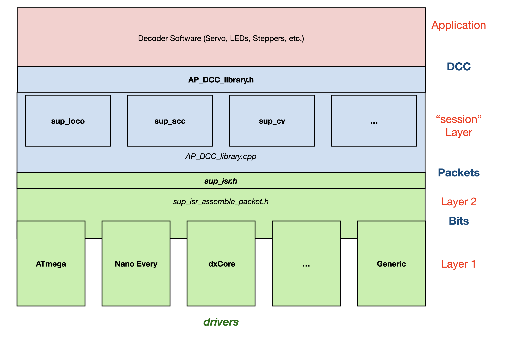
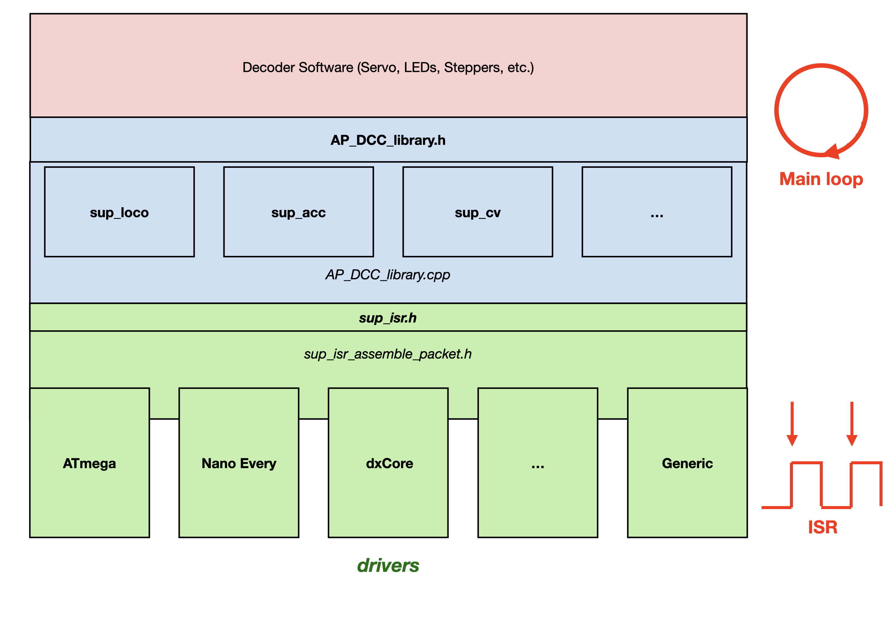

# Library modules

The library consists of several modules, whose structure and responsibilities are explained below.

The functionality of the various modules resembles the layered structure known from network reference models such as TCP/IP or OSI. Each layer has a clearly defined responsibility and interface, allowing the library to support different decoding strategies and hardware platforms without affecting application-level code.

---

## Interface to the user Application

At the top of the structure (shown in red in the figure) is the **application program**.
It uses the DCC information provided by this library to perform decoder-specific tasks, such as driving a motor in a locomotive decoder or operating servos, relays, or steppers in an accessory decoder. The red part should be coded by the user of this library.

The blue (and green) parts of the figure are implemented by this library. The blue part consists of the files `AP_DCC_library`, `sup_loco`, `sup_acc`, and `sup_cv`.
This layer is comparable to the session / presentation layer of the OSI model. It presents all relevant DCC information to the application in a structured and decoder-oriented form.

Information is exposed via the `loco`, `accessory`, and `cv` objects, which are defined as C++ classes in `AP_DCC_library.h`.
The prefix `sup` stands for *support*: these files are part of the internal implementation and are not intended to be accessed directly by application code.

To perform its tasks, `AP_DCC_library.cpp` analyses the contents of received DCC packets. It verifies whether the address contained in a packet matches the configured decoder address. Packets for other decoders are discarded at this level.

If the address matches and the packet contains a locomotive command, speed, direction, and function data are extracted and made available through the `loco` object.
If the packet contains an accessory command, the addressed output and requested state are extracted and made available through the `accessory` object.
All interpretation of the *contents* of DCC packets is handled exclusively in this blue layer.

## Packet Interface

The interface between the interrupt-driven decoding logic (green modules) and the packet interpretation logic (blue modules) is formed by the internal `DccMessage` structure.

`DccMessage` is a **low-level handoff buffer** that is written from interrupt context and consumed by the blue parts which in turn are triggered from the main loop. It contains:
- a flag indicating that a complete DCC packet is available,
- the length of the packet,
- the raw DCC packet bytes.

Ownership of `DccMessage` lies with the decoding layer: drivers and ISR-related code (within the `variants` files) assemble bits into a packet and, once complete, store the raw data in `DccMessage` and set its `isReady` flag.

It is important to understand that the application (user) code can not and should not access  `DccMessage` directly. Application code is expected to interact with received packets exclusively through the `Dcc`, `loco`, `accessory`, and `cv` classes

The application’s main loop repeatedly calls `dcc.input()`. This call acts as the synchronization point between interrupt-driven code and application-level logic: it consumes a completed packet from `DccMessage`, processes it, and clears the internal `isReady` flag in a controlled and atomic manner.

This separation ensures that interrupt-level details and driver-specific timing considerations remain fully isolated from application code, while allowing different decoding strategies and hardware platforms to share a stable, processor-independent API.

---

## Packet assembly (data link layer)

The functionality of `sup_isr` and `sup_isr_assemble_packet.h` is comparable to the data link layer (layer 2) of the OSI model.
This layer receives individual bits from the underlying drivers and assembles them into valid DCC packets. In network terms, it performs *framing and delimiting*.

Once a complete packet has been assembled and validated at this level, it is handed off to the higher layer via `DccMessage`.

---

## Physical decoding layer (drivers)

The functionality of the drivers is comparable to that of the physical layer (layer 1) of the OSI model.
Drivers measure the duration of individual DCC pulses on the track to determine whether a logical `0` or `1` was transmitted. Each driver implements a decoding strategy tailored to the peripherals and timing capabilities of a specific microcontroller family.

A generic driver (`Generic.h`) is provided that runs on all supported platforms. It avoids the use of hardware-specific peripherals and relies solely on standard Arduino functions such as `attachInterrupt()` and `micros()`. While this approach maximizes portability, its timing precision and efficiency may be limited.

To achieve higher decoding accuracy and efficiency, drivers for modern microcontrollers exploit advanced peripherals such as hardware timers, event systems, and input capture units. These peripherals can measure pulse durations with microsecond or sub-microsecond precision, often without CPU involvement. In contrast, the Arduino `micros()` function has a resolution of 4 µs, and pulse length measurement involves two such calls, leading to a potential timing error of up to 8 µs. Additionally, `attachInterrupt()` introduces non-negligible overhead and may be delayed by other interrupts.

As a result, while the generic driver may be sufficient in practice, it does not reliably meet the most stringent DCC timing requirements, and RailCom transmission may not be dependable when using this approach.

---

## Implemented drivers

Currently, the following drivers are implemented (additional drivers may follow):

- **`Mega.h`**
  Driver for traditional ATmega processors such as the ATmega328 (UNO, Nano) and ATmega2560 (Mega). It uses a hardware timer instead of `micros()` to achieve more precise timing.

- **`MegaCoreX_DxCore.h`**
  Highly optimized driver for modern AVR processors, including ATmega4808/4809, AVR Dx-series, and tinyAVR 0/1/2-series. It requires the MegaCoreX or DxCore board package and leverages the Event System and TCB timers for precise half-bit DCC decoding.

- **`Nano_Every.h`**
  Driver for the Arduino Nano Every that can be used with the standard Arduino core. It relies on conventional timing mechanisms and is primarily intended for compatibility; using MegaCoreX together with the `MegaCoreX_DxCore` driver is strongly preferred.

- **`ESP32.h`**
  Driver for ESP32 boards that measures full DCC bit times using the high-resolution system timer (`esp_timer_get_time()`). It uses a single GPIO interrupt for edge detection. While more precise than the generic driver, it does not support half-bit capture or strict RCN-210 timing, and RailCom detection is not implemented.

- **`STM32.h`**
  High-performance driver for STM32 microcontrollers. It uses a hardware timer in input capture mode to measure DCC half-bit durations with minimal ISR overhead (approximately 3 µs total). The default input pin is PB6 with TIM4, but this can be changed by adjusting configuration defines after consulting the STM32 reference manual. This driver provides precise timing, robust decoding, and a solid basis for future RailCom support.

---

## When are modules executed?

The files in the blue blocks are executed from the program’s main loop. How frequently they are called depends on the workload of the application and the processor’s speed.

The files in the green blocks are triggered by DCC-related interrupts. These interrupts occur roughly every 60 to 120 µs and perform time-critical tasks such as decoding DCC bits and assembling packets.

## Driver documentation

- [Generic driver](generic.md)
- [Mega (ATmega) driver](mega.md)
- [MegaCoreX / DxCore driver](megacorex-dxcore.md)
- [Nano Every driver](nano_every.md) (for compatibility only)
- [STM32 driver](stm32.md)
- [ESP32 driver](esp32.md)
